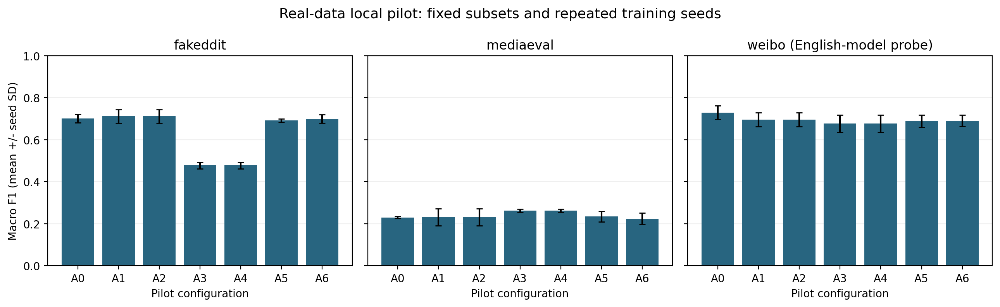

# Measured local ablation pilot

These are real subset measurements, not final paper evidence. Training seeds per dataset: {'mediaeval': 5, 'fakeddit': 5, 'weibo': 5}. The model uses frozen CLIP features, small fusion heads, train-caption retrieval and MiniLM NLI; it does not reproduce the manuscript's full architecture.

## Macro F1 (mean ± sample SD)

| Configuration | Fakeddit | MediaEval | Weibo (English-model probe) |
|---|---:|---:|---:|
| A0 | 0.7014 ± 0.0207 | 0.2301 ± 0.0049 | 0.7290 ± 0.0325 |
| A1 | 0.7111 ± 0.0323 | 0.2306 ± 0.0406 | 0.6951 ± 0.0338 |
| A2 | 0.7111 ± 0.0323 | 0.2306 ± 0.0406 | 0.6951 ± 0.0338 |
| A3 | 0.4771 ± 0.0162 | 0.2625 ± 0.0073 | 0.6764 ± 0.0420 |
| A4 | 0.4771 ± 0.0162 | 0.2625 ± 0.0073 | 0.6764 ± 0.0420 |
| A5 | 0.6912 ± 0.0081 | 0.2341 ± 0.0255 | 0.6881 ± 0.0287 |
| A6 | 0.6994 ± 0.0206 | 0.2245 ± 0.0271 | 0.6903 ± 0.0269 |

## What to use

Retained subset sizes: {'mediaeval': {'test': 100, 'val': 100, 'train': 400}, 'fakeddit': {'test': 100, 'val': 100, 'train': 399}, 'weibo': {'test': 100, 'val': 100, 'train': 400}}. Execution devices: {'mediaeval': 'cpu', 'fakeddit': 'cpu', 'weibo': 'cpu'}.

Each dataset folder has CSV/LaTeX tables, per-seed metrics, numeric expert scores, predictions, paired bootstrap intervals, nominal McNemar tests with Holm correction, calibration plots, score-stress curves, cost policies, context coverage, and head-only efficiency. Figures are supplied as PNG, PDF and SVG. Manifests and subset IDs record provenance.

## Interpretation limits

- A0 is early fusion; A1 hierarchical attention; A2 adds DTF; A3 adds evidence; A4 combines raw experts; A5 calibrates; A6 gates. A2/A3 are uncalibrated/ungated.
- These measurements do not automatically support the proposed hypotheses. Negative changes are retained.
- MediaEval repeats images across posts; clustered intervals account for exact-image repetition. Check the recorded unique-image counts and validation/test gap before drawing transfer conclusions.
- Weibo uses English CLIP/NLI solely to exercise the pipeline. It cannot support multilingual performance claims.
- Retrieved training captions are not independent fact-checked evidence. Availability is candidate availability, not annotated relevance. Retrieval relevance/stance scores and E0–E4 are not established by this pilot.
- Timings are fusion-head only, affected by concurrent local workload; not end-to-end latency or retrieval cost. Hardware is recorded per run; see the protocol for the development laptop's CUDA-driver limitation.
- Score degradation is not passage corruption. Domain support strata do not substitute for controlled history corruption.
- The original paper's cost claims at lambda <= 1 contradict its stated perfect-review cost model; the implemented validation-selected policy correctly chooses zero review there.

See [the full protocol and remaining work](../docs/ablation_protocol.md) before using values in a paper.
